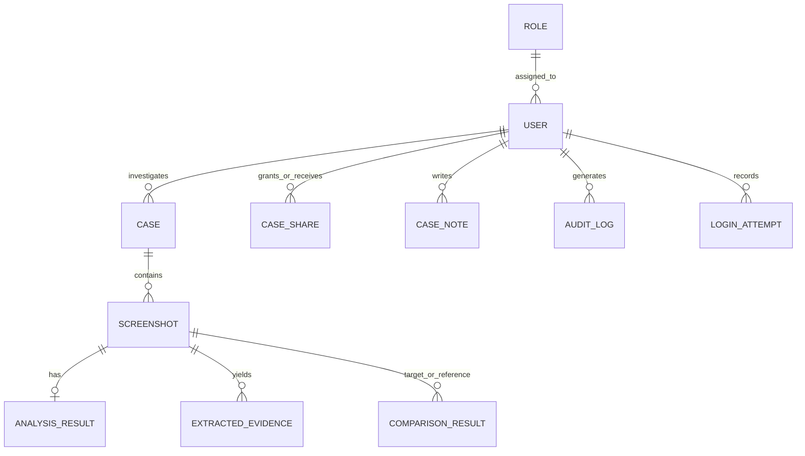
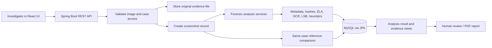
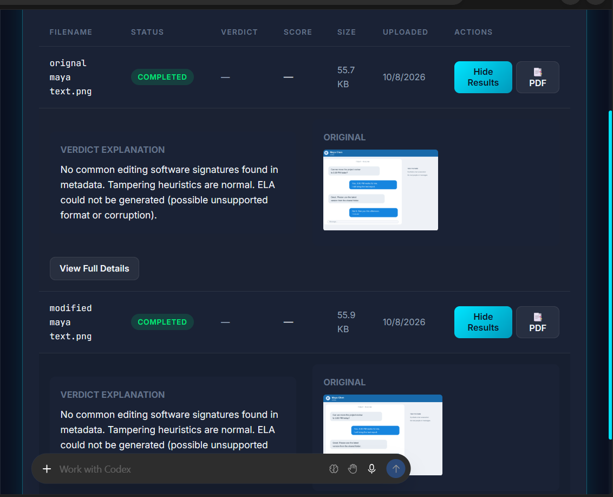
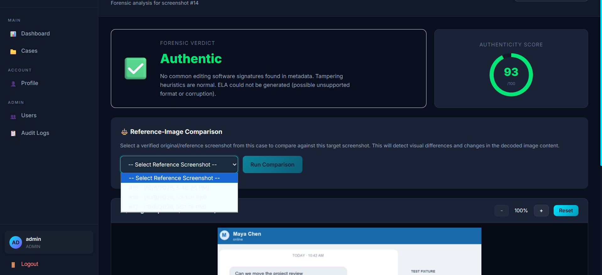
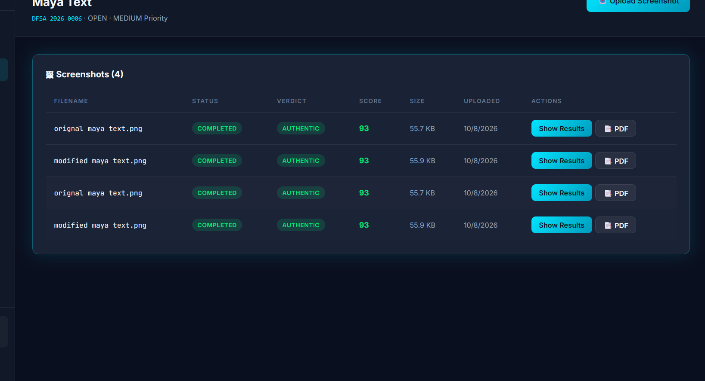

# Digital Forensic Screenshot Analyzer

### A Java-based platform for organizing screenshot evidence and reviewing forensic indicators.


## Quick Access — Project Links

| Resource | Access |
|---|---|
| GitHub Source Code | [Digital Forensic Screenshot Analyzer](https://github.com/RohitSuthar01/Digital-Forensic-Screenshot-Analyzer) |
| Local Frontend | Open the URL printed by Vite after starting the frontend (commonly `http://localhost:5173`) |
| Local Backend API Documentation | `http://localhost:8091/swagger-ui.html` after starting the backend |
| Project Screenshots | See the screenshot gallery later in this README. The original image links are preserved. |

> **Deployment note:** Vercel can host the frontend, but it does not automatically host this Java/Spring Boot backend, database, or permanent evidence storage. Configure and verify those services separately before sharing a production URL.

## Demo Login Credentials

These development/demo accounts are defined by the project's database seeder. Use the **username** and password in the login form.

| Role | Username | Password |
|---|---|---|
| Administrator | `admin` | `Admin@123` |
| Investigator | `investigator1` | `Invest@123` |
| Viewer | `viewer1` | `Viewer@123` |

> **Important:** The seeder creates each account only if that username does not already exist. If an existing database already contains the account, its saved password may be different. These public demo credentials are for local academic demonstration only; change or disable them before any real deployment.


## Team Members and Project Roles

The following table summarizes the team's documented module responsibilities. It describes the planned role distribution and is not, by itself, a claim about individual Git commit authorship.

| Team Member | RTU Roll Number | Project Role | Key Responsibilities |
|---|---|---|---|
| Rohit Suthar | `24EARCS138` | Team Lead and Backend Integration | Coordinates the team; integrates the backend workflow; explains analysis orchestration, API/service flow, and same-case image comparison. |
| Ritika Sharma | `24EARCS136` | Frontend UI/UX | Develops React/Vite pages, navigation, responsive layouts, upload and analysis screens, API integration, and loading/error/result states. |
| Ronak Thadani | `24EARCS139` | Case Management and Database | Supports case and screenshot workflows, JPA persistence, entity/repository relationships, and database-backed result retrieval. |
| Tanishk | `24EARCS172` | Image Forensics | Works on metadata, MD5/SHA-256 fingerprints, ELA, OCR, LSB screening, perceptual hashing, and heuristic indicators with their limitations. |
| Rishi | `24EARCS133` | Testing and Documentation | Plans and reviews tests, checks workflow behavior, reviews reports, documents limitations, and supports project presentation. |

## Main User Workflow

1. Sign in with an account that has the required role.
2. Create or open an investigation case.
3. Upload a supported screenshot to that case.
4. Start analysis and wait for its saved status and result.
5. Review the available metadata, hashes, ELA image when applicable, OCR text, and other screening indicators.
6. Select a target and reference screenshot from the **same case** and run comparison.
7. Review the explanation and limitations, then generate a PDF report if needed.

A hash mismatch means the file bytes differ; it does not prove that one image was edited or identify which image is original. Analysis outputs are indicators for human review, not a validated probability or proof of authenticity.

## Suggested Faculty Demo

1. Sign in using the local demo investigator account.
2. Create a clearly named test case.
3. Upload two labeled test images into that one case.
4. Open the analysis result and explain the available indicators and any unavailable modules.
5. Run a same-case comparison and explain what the hashes and pixel threshold actually measure.
6. Refresh the case page to check persistence and open the PDF report.

Use test images only; do not expose private screenshots, passwords, or real case evidence during a public demonstration.
---

## Week 1: Project Administration and Problem Definition

## Project Administration

**Project Guide:** Er. Ram Babu Buri  
**Department:** Computer Science and Engineering  
**Institution:** Arya College of Engineering & IT  
**Project Type:** Digital forensics web application

### Team Members

| Member | RTU Roll Number | Project Role | Email | Mobile |
| :--- | :--- | :--- | :--- | :--- |
| Rohit Suthar | 24EARCS138 | Team lead, backend integration, analysis workflow, and case comparison | rohitsutharrr@gmail.com | 7426033714 |
| Ritika Sharma | 24EARCS136 | React frontend, user experience, upload and analysis pages | ritikasharmapinjor@gmail.com | 9138266159 |
| Ronak Thadani | 24EARCS139 | Case and database workflow, persistence, and backend support | thadanir8@gmail.com | 8000387244 |
| Tanishk | 24EARCS172 | Image-forensics methods, metadata, hashes, ELA, OCR, and LSB screening | tanishk.99s99@gmail.com | 9461116756 |
| Rishi | 24EARCS133 | Test planning, workflow verification, report review, and documentation | Not provided | 8441000770 |

### Problem Statement

Screenshots are easy to copy, recompress, crop, or edit, while visual inspection alone may not reveal every change. Investigators also need a consistent way to preserve uploaded files, associate them with cases, record analysis output, and compare evidence without confusing screenshots from unrelated cases.

### Project Objectives

- Accept supported screenshot and image files and associate them with an investigation case.
- Preserve uploaded evidence and record its file details and cryptographic fingerprints.
- Extract image metadata and compute forensic indicators using the implemented Java analysis modules.
- Present findings, limitations, and comparison output through a web interface and downloadable report.
- Keep case access, user roles, and important actions within a managed application workflow.

---

## Week 2: Abstract and Project Scope

## Abstract

Digital screenshots are frequently used to document conversations, transactions, and other events. Since image editing and recompression can alter a file without making every change obvious to a viewer, a repeatable evidence-review workflow is useful. A screenshot should be examined with several independent indicators and its findings should be presented with appropriate limitations.

The Digital Forensic Screenshot Analyzer is a web application with a Java 17 and Spring Boot backend and a React/Vite frontend. Its backend contains modules for image metadata, file hashes, Error Level Analysis (ELA), OCR-based evidence extraction, LSB steganography screening, perceptual hashing, and tampering heuristics. It also manages users, cases, screenshots, analysis results, comparisons, notes, and audit records using JPA and MySQL.

The application provides investigators with case-based uploads, analysis result views, image inspection, reference-image comparison, dashboards, and PDF reporting. The output is intended to support human review: hashes establish exact byte equality or difference, while ELA and other heuristics indicate patterns that may warrant further investigation. No single score or visual map is treated as conclusive proof that an image is authentic or manipulated.

### Scope and Limitations

- Analysis results are indicators, not a definitive determination of authenticity or intent.
- A cryptographic hash changes when file bytes change; it does not explain why they changed.
- Metadata may be absent, stripped, or rewritten by applications and platforms.
- ELA and tampering heuristics can produce false positives or miss edits, especially after resizing, recompression, or screenshot recapture.
- OCR and LSB screening depend on image quality, encoding, and implementation limits.
- Findings should be corroborated with original files, chain-of-custody information, and independent examination where required.

---

## Week 3: Requirements and User Roles

## User Roles

The backend defines the roles `ADMIN`, `INVESTIGATOR`, and `VIEWER`.

- **Administrator:** Performs administrative actions and reviews system-level users or audit information, subject to the configured authorization rules.
- **Investigator:** Creates and manages cases, uploads screenshots, requests analysis, reviews results, and performs case-level comparison.
- **Viewer:** Reviews information made available to the viewer by the application’s access rules.

### Functional Requirements

1. Users can sign in and use functions permitted by their role.
2. Investigators can create and view cases and upload image evidence to a case.
3. The application can run image analysis and persist associated results.
4. Users can review extracted metadata, hashes, forensic indicators, and evidence text when available.
5. A target screenshot can be compared with a reference screenshot belonging to the same case.
6. Case notes, audit records, and PDF reports support investigation review.

### Non-Functional Requirements

- Validate uploads and handle unsupported or unreadable images with useful errors.
- Keep uploaded evidence outside the frontend web root using the configured upload directory.
- Enforce authorization on protected API operations.
- Return structured API responses that the React application can display.
- Explain uncertainty and avoid presenting heuristic indicators as proof.

---

## Week 4: System Architecture and Core Modules

## Architecture & Core Modules

### Module 1: Authentication and Authorization

Spring Security and the authentication controllers manage sign-in and role-aware application access. The role model includes administrator, investigator, and viewer permissions.

### Module 2: Case and Evidence Management

Case and screenshot services manage investigation records and the relationship between cases and uploaded files. Evidence metadata is persisted through JPA repositories.

### Module 3: Forensic Analysis

The Java forensic package contains metadata analysis, ELA, OCR/evidence extraction, LSB screening, perceptual hashing, tampering heuristics, and authenticity scoring. These methods provide separate indicators for human review.

### Module 4: Image Comparison

The comparison service and frontend comparison panel support a target-versus-reference workflow. Comparisons are case-scoped so that evidence from a different case is not treated as that case’s reference.

### Module 5: Dashboard, Audit, and Reporting

Dashboard services summarize application activity, audit services record relevant events, and report services generate PDF output for review.

### Module 6: Web Interface

The React/Vite frontend provides landing, authentication, dashboard, case, upload, analysis, profile, administration, audit, and comparison views. A Three.js-based hero scene is also present in the frontend.

---

## Week 5: Technology and Database Design

## Tech Stack

| Layer | Technology |
| :--- | :--- |
| Backend language | Java 17 |
| Backend framework | Spring Boot 3.2.0, Spring MVC |
| Persistence | Spring Data JPA, Hibernate |
| Database | MySQL |
| Security | Spring Security, role-based access control |
| Image metadata | metadata-extractor |
| OCR | Tess4J / Tesseract integration |
| PDF reports | OpenPDF |
| Hash utilities | Apache Commons Codec and Java security APIs |
| Frontend | React 18, Vite, JavaScript, HTML, and CSS |
| UI and visualization libraries | Bootstrap, Framer Motion, Recharts, Three.js, React Three Fiber, and Drei |
| Build tools | Maven and npm |

## Database Design

The application models users, roles, cases, screenshots, analysis results, extracted evidence, comparison results, case notes, case shares, audit logs, and login attempts. The exact installed schema is defined by the entity mappings and database configuration in the backend.



## Data Flow



---

## Week 6: Frontend and Case Workflow

### Role & Scope of Work

The team connected the React application pages to the case and screenshot workflow exposed by the backend. Work in this phase covers navigation, authentication screens, case lists and details, upload screens, and display of analysis status.

### Main Deliverables

- React routes and pages for landing, login, registration, dashboard, cases, upload, profile, and analysis.
- Reusable layout and navigation components, including the sidebar and image-inspection components.
- API integration for creating or opening cases and submitting screenshots.
- User-facing handling of loading, empty, and error states.

### Problems and Responses

1. **Frontend and backend run on different local ports:** CORS configuration is required for the local Vite origins configured by the backend.
2. **Upload and analysis are asynchronous:** The interface must show the current status and retrieve the persisted result rather than assuming analysis is complete immediately.
3. **Large or unsupported files can fail:** The backend multipart limits and image validation should be communicated through clear UI feedback.

---

## Week 7: Image Metadata, Hashing, and Evidence Preservation

### Role & Scope of Work

This phase focuses on file intake and the evidence record. Uploaded files are linked to a case, stored under the configured upload directory, and represented by database records. The analysis modules extract image properties and calculate file fingerprints used to distinguish exact file equality from visual similarity.

### Main Deliverables

- Screenshot upload and case association.
- Metadata extraction through the metadata analysis module.
- Cryptographic hash generation for file fingerprinting.
- File utility validation and storage support.
- Persistence of screenshot and analysis records.

### Problems and Responses

1. **Metadata may be missing:** Display unavailable metadata as unavailable; do not infer that missing metadata proves manipulation.
2. **Identical-looking files can have different bytes:** Explain cryptographic hashes as exact-file fingerprints and use perceptual comparison for visual similarity.
3. **Evidence files must remain accessible:** Keep the upload directory configurable and store a database reference rather than relying on a temporary browser path.

---

## Week 8: Forensic Indicators and Evidence Extraction

### Role & Scope of Work

The forensic-analysis phase combines independent checks. ELA, metadata, OCR, LSB screening, perceptual hashing, and tampering heuristics are implemented as distinct analysis components, then coordinated by the analysis service.

### Main Deliverables

- Error Level Analysis output for supported image formats.
- OCR-based text and evidence extraction.
- LSB steganography screening.
- Perceptual hash generation for near-duplicate comparisons.
- Heuristic scoring and result mapping for the UI.

### Problems and Responses

1. **ELA depends on image format and compression:** Clearly indicate when ELA is unsupported or unavailable and avoid showing an empty or misleading preview.
2. **OCR can misread small or low-quality text:** Treat OCR output as extracted evidence requiring human verification.
3. **Heuristic indicators are not certainty:** Present explanations and limitations alongside scores and avoid claiming a perfect authenticity verdict.

---

## Week 9: Same-Case Comparison and Results Interface

### Role & Scope of Work

This phase connects reference-image selection, comparison execution, persistence, and visualization. The comparison workflow is limited to screenshots in the selected case and reports the measured file or visual differences supported by the implementation.

### Main Deliverables

- Reference selection and target/reference comparison controls.
- Case-scoped reference options and backend ownership/access checks.
- Comparison result persistence and display.
- Image inspector with zoom and comparison visualization.
- Analysis-result page with evidence, indicators, and result explanation.

### Problems and Responses

1. **Comparing across unrelated cases can mislead:** Restrict selectable references to the current case and validate case membership on the server.
2. **Images may have different dimensions:** Normalize or align images for visual comparison and disclose the normalization used.
3. **Raw pixel differences are sensitive to resizing and compression:** Describe visual difference output as a comparison aid, not proof of tampering.

---

## Week 10: Security, Audit, Dashboard, and Reports

### Role & Scope of Work

This phase covers access controls and supporting investigation features. The backend includes security, case access, audit logging, dashboard services, and PDF report generation. Administrative pages expose user and audit workflows when authorized.

### Main Deliverables

- Role-aware APIs for administrator, investigator, and viewer roles.
- Case-sharing and access-control services.
- Audit events and login-attempt records.
- Dashboard statistics and recent activity views.
- PDF report generation for analysis results.

### Problems and Responses

1. **Direct API calls can bypass hidden UI controls:** Enforce authorization at the backend endpoint and service layer.
2. **Sensitive configuration should not be committed:** Supply database and deployment settings through local configuration or environment variables; never document real passwords.
3. **A report can overstate a heuristic:** Include evidence values and uncertainty rather than claiming a definitive forensic conclusion.

---

## Week 11: Testing and Integration Review

### Testing Coverage Present in the Repository

The backend contains tests for authenticity scoring, ELA, LSB analysis, metadata analysis, BCrypt behavior, analysis service, case access, comparison service, screenshot service, and file utilities. These test files show intended coverage; a successful current test run must be confirmed in the target environment before claiming the project passes.

### Integration Checklist

- Verify MySQL is available and the configured database is correct.
- Verify the backend starts on its configured port and the frontend can reach it.
- Verify registration or login and role-specific access.
- Create one case, upload a supported image, and confirm the screenshot record is visible.
- Run analysis and confirm its result loads after completion or refresh.
- Upload a second image into the same case and compare only those case images.
- Try invalid, unsupported, oversized, and unreadable files and check for useful errors.
- Review generated PDF output, audit records, and image previews.

### Common Integration Issues and Responses

1. **Dashboard or API request fails:** Check backend availability, frontend API base URL, CORS origins, database status, and browser network response.
2. **Analysis remains pending:** Check backend logs and persisted analysis status; ensure asynchronous failures are surfaced and retried or marked failed rather than silently left pending.
3. **Image preview is blank:** Verify the stored-file endpoint, content type, authorization, and configured upload path.

---

## Week 12: Final Evaluation and Deliverables

### Project Deliverables

- Java 17 / Spring Boot backend source.
- React/Vite frontend source.
- MySQL entity and repository layer.
- Screenshot case-management and analysis workflows.
- Forensic indicator modules and test sources.
- Comparison, dashboard, audit, and report features.
- This README as project and phase documentation.

### Final Evaluation Criteria

- A user can authenticate and access permitted pages.
- An investigator can create a case, upload supported images, and retrieve analysis results.
- Analysis output includes available evidence and explains unsupported or uncertain checks.
- Comparison only uses images from the same case and returns a readable result.
- Failures are visible to the user and diagnosable from application logs.
- README setup instructions match the actual repository layout and avoid secret values.

### Team Module Distribution

| Member | Module / Responsibility | Key Deliverables |
| :--- | :--- | :--- |
| Rohit Suthar | Team coordination, backend integration, analysis workflow, and comparison | API/service integration, case workflow coordination, same-case comparison review |
| Ritika Sharma | Frontend UI/UX | React/Vite pages, navigation, upload and results interface, responsive UI |
| Ronak Thadani | Case and database workflow | Case/evidence persistence, JPA entities and repositories, related API support |
| Tanishk | Image-forensics analysis | Metadata, hashing, ELA, OCR, LSB screening, perceptual and heuristic modules |
| Rishi | Testing and documentation | Test planning and review, workflow verification, project documentation |

The table records the project’s planned responsibility split and should not be treated as a statement of individual Git authorship.

---

## Project Directory Structure

```text
ScreenShot_Detector/
├── dfsa/
│   ├── backend/
│   │   ├── pom.xml
│   │   └── src/
│   │       ├── main/java/com/dfsa/
│   │       │   ├── config/
│   │       │   ├── controller/
│   │       │   ├── dto/
│   │       │   ├── exception/
│   │       │   ├── forensic/
│   │       │   ├── mapper/
│   │       │   ├── model/
│   │       │   ├── repository/
│   │       │   ├── security/
│   │       │   ├── service/
│   │       │   └── util/
│   │       ├── main/resources/
│   │       └── test/java/com/dfsa/
│   └── frontend/
│       ├── package.json
│       ├── vite.config.js
│       └── src/
│           ├── api/
│           ├── components/
│           ├── context/
│           ├── hooks/
│           ├── pages/
│           ├── routes/
│           ├── styles/
│           └── three/
├── README.md
└── SUMMARY.md
```

---

## Installation and Usage

### Prerequisites

- Java Development Kit (JDK) 17
- Maven 3.8+ (or the Maven wrapper if present)
- Node.js and npm compatible with the Vite project
- MySQL 8.x
- Tesseract OCR installed and configured for Tess4J if OCR is enabled

### 1. Configure MySQL

Create a MySQL database named `dfsa`. Configure `DB_URL`, database username, and database password for the backend. Keep credentials private and out of Git.

### 2. Start the Backend

```bash
cd dfsa/backend
mvn spring-boot:run
```

The checked-in configuration uses port `8091` by default. Confirm the effective configuration in `src/main/resources/application.properties` before running.

### 3. Start the Frontend

Open a second terminal:

```bash
cd dfsa/frontend
npm install
npm run dev
```

Open the local URL printed by Vite. The backend CORS configuration must allow that frontend origin.

### 4. Run Backend Tests

```bash
cd dfsa/backend
mvn test
```

Test results depend on the local Java, Maven, database, and OCR environment. Review the test output instead of assuming a passing result.

---

## UI Screenshots

The following development screenshots show the case evidence list, the analysis and reference-comparison interface, and analysis results inside a case. The analysis values shown are examples of the application UI at the time of capture; they are not independent ground-truth validation of the forensic verdict.

### Case Evidence

The case page groups uploaded screenshots under a single investigation and exposes each item’s status and analysis actions.



### Analysis and Reference Comparison

The analysis view displays the current verdict and score, and provides a selector for choosing a reference screenshot for comparison.



### Case Analysis Results

The case results table summarizes uploaded images and their current analysis status, verdict, and score.



---

## Future Scope

- Add a documented chain-of-custody export with file hashes and timestamped events.
- Improve comparison reports with clear metric definitions and region-level annotations.
- Add configurable batch analysis with queue status and recovery for failed jobs.
- Expand test fixtures for JPEG, PNG, WebP, resized images, recompressed images, and known edited samples.
- Improve calibration and explainability of heuristic scores using a labeled evaluation dataset.
- Add deployment guidance, observability, and secure secret management for production.

---

## References

- [Spring Boot Reference Documentation](https://docs.spring.io/spring-boot/)
- [Spring Security Reference](https://docs.spring.io/spring-security/reference/)
- [React Documentation](https://react.dev/)
- [Vite Documentation](https://vite.dev/guide/)
- [Metadata Extractor](https://github.com/drewnoakes/metadata-extractor)
- [Tess4J](https://github.com/nguyenq/tess4j)
- [OpenPDF](https://github.com/LibrePDF/OpenPDF)
- [Apache Commons Codec](https://commons.apache.org/proper/commons-codec/)
- [MySQL Documentation](https://dev.mysql.com/doc/)

---

## License

No license file was identified in the project root when this README was prepared. Add a license file and update this section if the project is distributed under a specific license.


